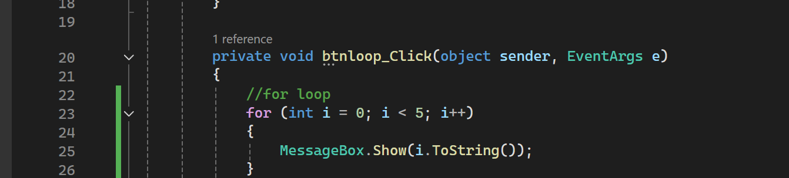
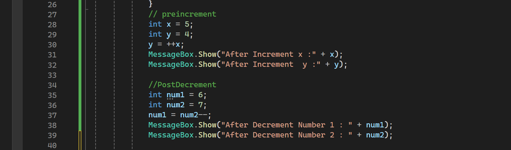
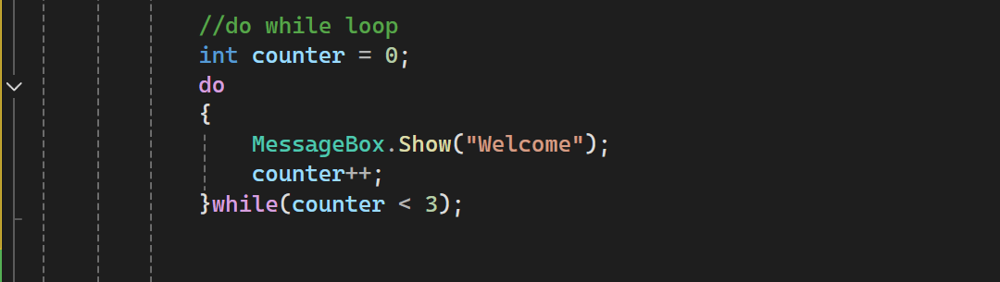

# C# Loops and Increment/Decrement Operators

## 1. For Loop

### Explanation
This code shows numbers from 0 to 4 using for loop. 
- `int i = 0`: Initializes the counter variable.
- `i < 5`: The condition that determines whether the loop continues.
- `i++`: Increases the counter by 1 after each iteration.
- `MessageBox.Show(i.ToString())`: Displays the current value of `i` in a message box.
### Code
```csharp
for (int i = 0; i < 5; i++)
{
    MessageBox.Show(i.ToString());
}
```
### Screenshot


---
## 2. Pre-Increment Operator (++x)

### Explanation
- `x = 5`: Initializes x with 5.
- `y = 4`: Initializes y with 4.
- `++x`: Increases x by 1 before assigning its value to y.
- `y = ++x`: Assigns the updated value of x to y.
### Code
```csharp
int x = 5;
int y = 4;

y = ++x;
MessageBox.Show("After Increment x :" + x);
MessageBox.Show("After Increment y :" + y);
```
### Screenshot

---

## 3. Post-Decrement Operator (x--)

### Explanation
- `num1 = 6`: Initializes num1 with 6.
- `num2 = 7`: Initializes num2 with 7.
- `num1 = num2--`: First assigns the original value of num2 to num1, then decreases num2 by 1.
### Code
```csharp
int num1 = 6;
int num2 = 7;

num1 = num2--;

MessageBox.Show("After Decrement Number 1 : " + num1);
MessageBox.Show("After Decrement Number 2 : " + num2);
```

### Screenshot

---
## 4. While Loop
### Explanation
This code will show the word  "Hello" five times using while loop
- `int count = 0`: Initializes the counter variable.
- `count < 5`: Checks whether the condition is true.
- `MessageBox.Show("Hello")`: Displays Hello in a message box.
- `count++`: Increases the counter by 1 after each iteration.

### Code
```csharp
int count = 0;

while (count < 5)
{
    MessageBox.Show("Hello");
    count++;
}
```
### Screenshot


---
## 5. Do-While Loop
### Explanation
This code will show the word  "Welcome" three times using while loop

- `int counter = 0`: Initializes the counter variable.
- `do`: Starts the loop body.
- `MessageBox.Show("Welcome")`: Displays Welcome.
- `counter++`: Increases the counter by 1.
- `while (counter < 3)`: Checks the condition after executing the loop body.

### Code
```csharp
int counter = 0;

do
{
    MessageBox.Show("Welcome");
    counter++;
}
while (counter < 3);
```
### Screenshot


---