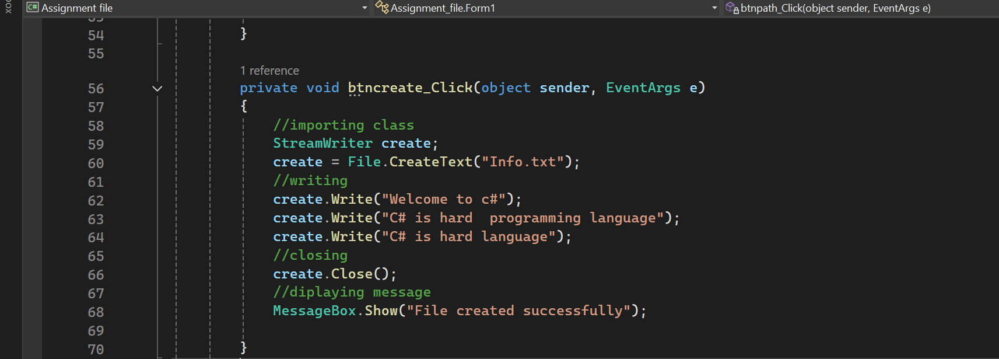
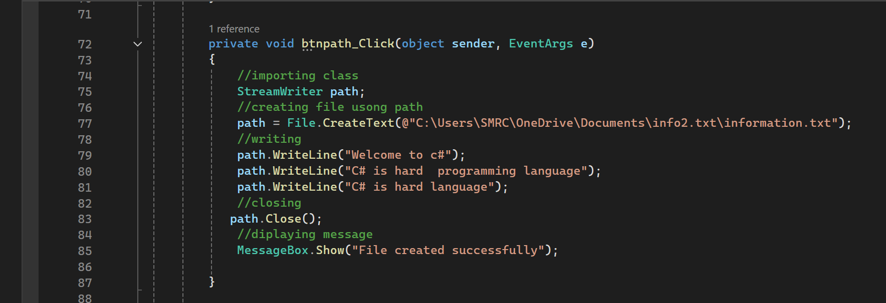
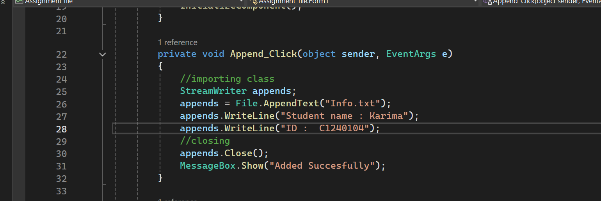
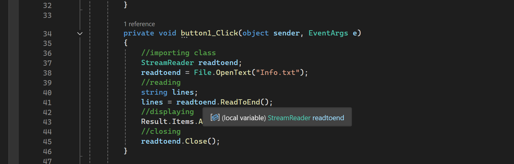
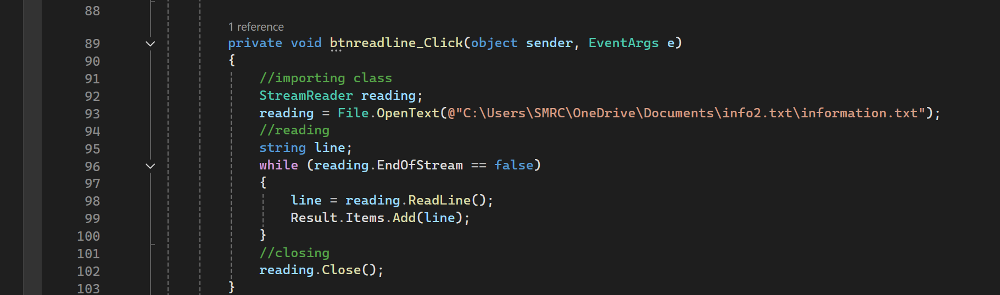
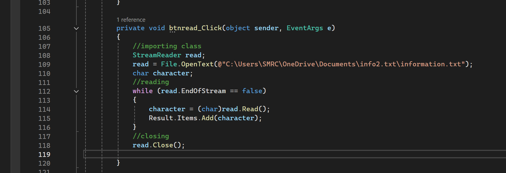
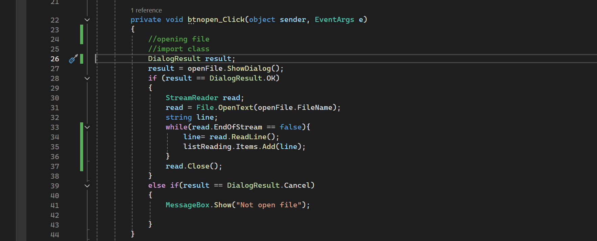
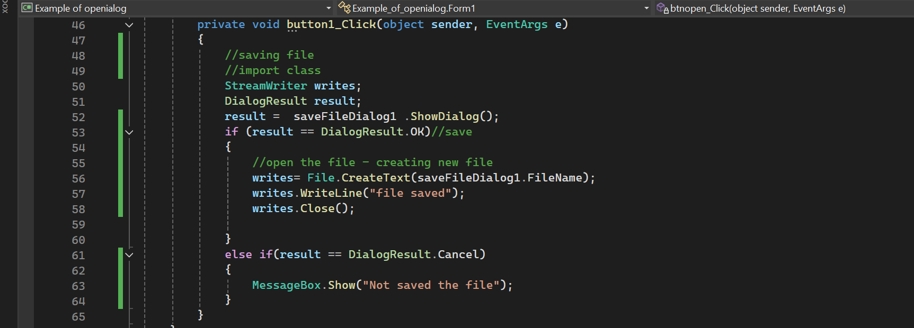

# C# File Handling Assignment

## Explaining  the code 
## Create Text File
This button creates a new text file called `Info.txt` and writes three sentences into it.
### Code
```csharp
private void btncreate_Click(object sender, EventArgs e)
{
    //importing class
    StreamWriter create;
    create = File.CreateText("Info.txt");
    //writing
    create.Write("Welcome to c#");
    create.Write("C# is hard  programming language");
    create.Write("C# is hard language");
    //closing
    create.Close();
    //diplaying message
    MessageBox.Show("File created successfully");
    
}
```

### Methods Used
- `File.CreateText()`: Creates a file or overwrites its existing content.
- `Write()`: Writes text without automatically moving to a new line.
- `Close()`: Closes the file connection.

### Screenshot


##  Create File Using a Specific Path
This button creates a text file in a specified directory using an absolute file path.
### Code
```csharp
private void btnpath_Click(object sender, EventArgs e)
{
    //importing class
    StreamWriter path;
    //creating file usong path
    path = File.CreateText(@"C:\Users\SMRC\OneDrive\Documents\info2.txt\information.txt");
    //writing
    path.WriteLine("Welcome to c#");
    path.WriteLine("C# is hard  programming language");
    path.WriteLine("C# is hard language");
    //closing
   path.Close();
    //diplaying message
    MessageBox.Show("File created successfully");
}
```

### Methods Used
- `File.CreateText()`: Creates the file at the specified location.
- `WriteLine()`: Writes information into the file, with each sentence on a separate line.
- `Close()`: Closes the file connection.

### Screenshot


##  Append Text to a File
This button adds student information to an existing file named `Info.txt` without deleting its previous content.
### Code
```csharp
private void Append_Click(object sender, EventArgs e)
{
    //importing class
    StreamWriter appends;
    appends = File.AppendText("Info.txt");
    appends.WriteLine("Student name : Karima");
    appends.WriteLine("ID :  C1240104");
    //closing
    appends.Close();
    MessageBox.Show("Added Succesfully");
}
```
### Methods Used
- `File.AppendText()`: Opens the file for adding new content. If the file does not exist, it creates one.
- `WriteLine()`: Writes information into the file and moves to a new line.
- `Close()`: Closes the file connection.
### Screenshot


##  Read To End

This button reads all the remaining content from `Info.txt` and displays it in the Result ListBox.
### Code
```csharp
private void button1_Click(object sender, EventArgs e)
{
    //importing class
    StreamReader readtoend;
    readtoend = File.OpenText("Info.txt");
    //reading
    string lines;
    lines = readtoend.ReadToEnd();
    //displaying
    Result.Items.Add(lines);
    //closing
    readtoend.Close();
}
```
### Methods Used
- `File.OpenText()`: Opens an existing text file for reading.
- `ReadToEnd()`: Reads all remaining content and returns it as a string.
- `Result.Items.Add()`: Displays the retrieved content in the ListBox.
- `Close()`: Closes the file connection.

### Screenshot



##  Read Line by Line

This button reads the contents of the file one line at a time and displays each line in the Result ListBox.
### Code
```csharp
private void btnreadline_Click(object sender, EventArgs e)
{
    //importing class 
    StreamReader reading;
    reading = File.OpenText(@"C:\Users\SMRC\OneDrive\Documents\info2.txt\information.txt");
    //reading
    string line;
    while (reading.EndOfStream == false)
    {
        line = reading.ReadLine();
        Result.Items.Add(line);
    }
    //closing
    reading.Close();
}
```
### Methods Used
- `File.OpenText()`: Opens the file for reading.
- `EndOfStream`: Checks whether the end of the file has been reached.
- `ReadLine()`: Reads one line at a time.
- `Result.Items.Add()`: Displays each line in the ListBox.
- `Close()`: Closes the file connection.
A `while` loop is used to continue reading until the end of the file.

### Screenshot


## Read Character by Character
This button reads the file one character at a time and displays each character in the Result ListBox.
### Code
```csharp
 private void btnread_Click(object sender, EventArgs e)
 {
     //importing class
     StreamReader read;
     read = File.OpenText(@"C:\Users\SMRC\OneDrive\Documents\info2.txt\information.txt");
     char character;
     //reading
     while (read.EndOfStream == false)
     {
         character = (char)read.Read();
         Result.Items.Add(character);
     }
     //closing
     read.Close();

 }
 ```
### Methods Used
- `File.OpenText()`: Opens the file for reading.
- `Read()`: Reads the next character and returns its integer character code.
- `(char)`: Converts the returned integer into a character.
- `EndOfStream`: Checks whether the end of the file has been reached.
- `Close()`: Closes the file connection.
A `while` loop is used to read characters until the end of the file.
### Screenshot


## Read All Text
This button reads the entire content of `Info.txt` and displays it in the Result ListBox.
### Code
```csharp
private void bbtnalltext_Click(object sender, EventArgs e)
{
    //reading using readalltext
    String all;
    all = File.ReadAllText("Info.txt");
    //displaying
    Result.Items.Add(all);
  

}
```
### Method Used
- `File.ReadAllText()`: Reads all the text from a file and returns it as a string.
- `Result.Items.Add()`: Displays the retrieved content in the ListBox.

### Screenshot


##  Opening and Reading a File (OpenFileDialog)

This button displays an Open File dialog box that allows the user to select an existing file. If the user selects a file, the program reads its contents line by line and displays them in a ListBox.

### Code

```csharp
private void btnopen_Click(object sender, EventArgs e)
{
    // Import class
    DialogResult result;

    result = openFile.ShowDialog();

    if (result == DialogResult.OK)
    {
        StreamReader read;
        read = File.OpenText(openFile.FileName);

        string line;

        while (read.EndOfStream == false)
        {
            line = read.ReadLine();
            listReading.Items.Add(line);
        }

        read.Close();
    }
    else if (result == DialogResult.Cancel)
    {
        MessageBox.Show("Not open file");
    }
}
```
### Screenshot



## 2. Saving a File (SaveFileDialog)
This button displays a Save As dialog box that allows the user to choose the location and name of a new file.
If the user click ok , the program creates the file and writes the text "file saved" into it.

### Code

```csharp
private void button1_Click(object sender, EventArgs e)
{
    // Import class
    StreamWriter writes;
    DialogResult result;

    result = saveFileDialog1.ShowDialog();

    if (result == DialogResult.OK)
    {
        // Open the file - creating a new file
        writes = File.CreateText(saveFileDialog1.FileName);

        writes.WriteLine("file saved");

        writes.Close();
    }
    else if (result == DialogResult.Cancel)
    {
        MessageBox.Show("Not saved the file");
    }
}
```
### Screenshot



